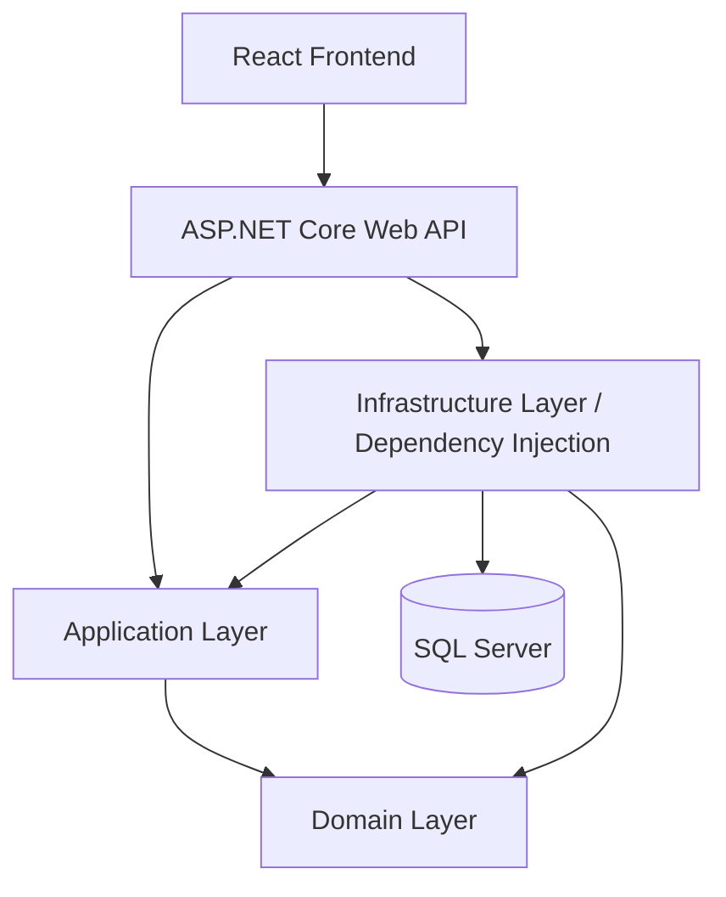

# E-Commerce & Retail Management Platform

A full-stack E-Commerce and Retail Management Platform designed to manage online shopping, physical store sales, inventory, order fulfillment, supplier invoices, and financial reporting through a unified system.

The project applies Clean Architecture, relational database design, RESTful API development, and modern frontend engineering practices.

## Table of Contents

- [System Overview](#system-overview)
- [Business Modules](#business-modules)
- [Technology Stack](#technology-stack)
- [System Architecture](#system-architecture)
- [Engineering Practices](#engineering-practices)
- [Database Design](#database-design)
- [Project Documentation](#project-documentation)
- [Security](#security)
- [Repository Structure](#repository-structure)
- [Getting Started](#getting-started)
- [Future Improvements](#future-improvements)

## System Overview

The platform serves two primary actors:

- **Customer:** Discover products, manage shopping carts, place orders, and view order history and fulfillment status.
- **Store Owner:** Manage products, categories, brands, inventory, orders, payments, physical store sales, suppliers, and financial reports.

## Business Modules

| Module | Capabilities |
| --- | --- |
| Identity & Access Management | Authentication and role-based authorization |
| Product Management | Products, variants, images, and technical specifications |
| Category & Brand Management | Product classification and organization |
| Product Discovery | Searching, filtering, sorting, and pagination |
| Inventory Management | Stock availability, reservations, and allocations |
| Shopping Cart | Add, update, remove, and clear cart items |
| Checkout | Order placement and delivery information |
| Payment Management | Cash on Delivery (COD) collection |
| Customer Order Management | Order history and order details |
| Store Order Management | Order processing, cancellation, and fulfillment tracking |
| Point of Sale (POS) | Physical store sales management |
| Supplier Management | Supplier records and management |
| Supplier Invoice Management | Supplier invoices, installment payments, and payment history |
| Financial Reporting | Sales and revenue reporting |

## Technology Stack

### Backend

- ASP.NET Core Web API
- C#
- Entity Framework Core
- Microsoft SQL Server
- ASP.NET Core Identity
- Serilog
- Swagger / OpenAPI
- Clean Architecture

### Frontend

- React and TypeScript
- Vite
- Redux Toolkit and RTK Query
- TanStack Router
- Tailwind CSS and shadcn/ui
- ESLint and Prettier
- Husky and Commitlint

## System Architecture

The backend follows Clean Architecture principles, separating business logic from infrastructure and presentation concerns.

| Layer | Responsibility |
| --- | --- |
| Domain | Business entities and domain rules |
| Application | Use cases, service contracts, validation, and business workflows |
| Infrastructure | Database persistence, repositories, and external implementations |
| API | HTTP endpoints, authentication, authorization, and request handling |



The diagram represents a high-level view of application interaction and backend dependencies. Infrastructure implements persistence abstractions defined by the application layer.

The frontend follows a feature-based architecture with separation between UI components, application state, routing, and API communication.

## Engineering Practices

- Separation of concerns, dependency inversion, and dependency injection
- Repository abstraction and RESTful API design
- Database constraints, referential integrity, and schema migrations
- Transaction management and optimistic concurrency control
- Idempotent request processing for selected write operations
- Structured application logging
- Server-side filtering, sorting, and pagination
- Role-based authorization and server-side validation
- Frontend code quality tooling and OpenAPI-based integration

## Database Design

The relational database supports product variants, inventory, stock reservations, COD allocations, orders, payments, physical store sales, supplier invoices, and supplier payments.

Entity Framework Core manages database persistence and schema migrations.

**[View Database Entity Relationship Diagram (PDF)](./docs/database/Database%20ER%20diagram.pdf)**

## Project Documentation

| Document | Description |
| --- | --- |
| [Software Requirements](./docs/requirements/E-Commerce_Project_Requirements_Revised_v2.pdf) | Functional requirements and business rules |
| [Database ERD](./docs/database/Database%20ER%20diagram.pdf) | Database entities and relationships |
| [Frontend Documentation](./frontend/docs/) | Frontend architecture and integration guides |

## Security

- ASP.NET Core Identity
- Cookie-based authentication
- Role-based access control
- Server-side request validation
- Secure authentication cookie configuration
- Private product image storage
- Separation of sensitive local configuration from source control

This project is a portfolio implementation, not a claim of production security certification. Additional hardening, including CSRF protection for cookie-authenticated state-changing requests, production TLS configuration, and a security review, is required before production deployment.

## Repository Structure

```text
ECommerce-Platform/
├── backend/
│   ├── E-Commerce/
│   ├── ECommerce.Domain/
│   ├── ECommerce.Application/
│   ├── ECommerce.Infrastructure/
│   ├── ECommerce.IntegrationTests/
│   └── E-Commerce.sln
├── frontend/
│   ├── src/
│   ├── docs/
│   ├── openapi/
│   ├── package.json
│   └── package-lock.json
├── docs/
│   ├── database/
│   └── requirements/
├── .gitignore
└── README.md
```

## Getting Started

### Prerequisites

- .NET SDK compatible with the backend project target framework
- Microsoft SQL Server (SQL Server Express is suitable for local development)
- Node.js and npm compatible with the frontend project
- Git
- EF Core CLI tools compatible with the project's EF Core version

### 1. Clone the Repository

```bash
git clone https://github.com/Qusai62/E-CommerceProject.git
cd E-CommerceProject
```

### 2. Backend Setup

Restore dependencies:

```bash
cd backend
dotnet restore E-Commerce.sln
```

Configure your local SQL Server connection through ASP.NET Core configuration. Use User Secrets or environment variables for sensitive values; do not commit credentials.

Apply migrations using the Infrastructure project and API startup project (from `backend/`):

```bash
dotnet ef database update --project ECommerce.Infrastructure --startup-project E-Commerce
```

Start the API:

```bash
dotnet run --project E-Commerce
```

Use the development URL reported by ASP.NET Core to access Swagger when enabled. Configure any required Store Owner seed settings locally before using the owner dashboard.

### 3. Frontend Setup

From the repository root, open a separate terminal:

```bash
cd frontend
npm ci
```

Copy `.env.example` to `.env.local` and configure the API URL and other required local settings. Never place secrets in client-side environment variables.

Start the development server:

```bash
npm run dev
```

Open the URL reported by Vite. The frontend and backend must use compatible development URLs and authentication configuration.

For additional frontend setup details, see the [Frontend README](./frontend/README.md).

### 4. Build Verification

From the repository root:

```bash
dotnet build backend/E-Commerce.sln
```

From the frontend directory:

```bash
npm run build
```

## Future Improvements

- Production deployment and CI/CD pipelines
- Expanded automated test coverage
- Additional security hardening
- Centralized logging and monitoring
- Advanced analytics and reporting
- Online payment gateway integration as an optional future extension (the current scope is COD only)

## Project Status

The core E-Commerce and Retail Management features have been implemented. Further improvements focus on deployment, security, testing, and maintainability.
